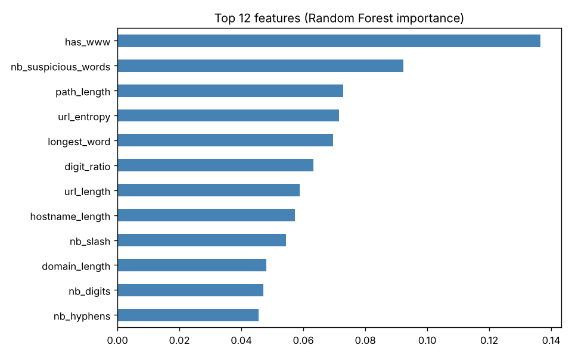
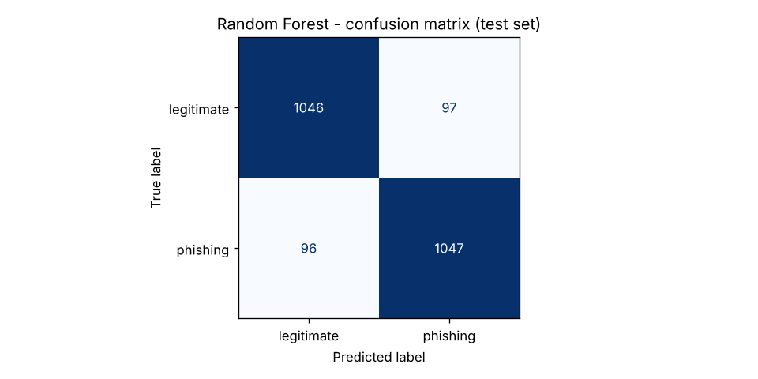
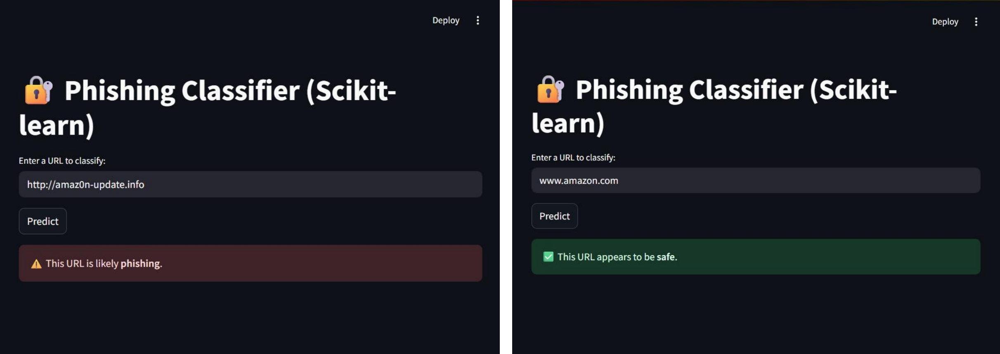

# Phishing Web Page Detection

Detects whether a URL is **phishing** or **legitimate** using only the text of the URL, with a
**Random Forest** model and a **Streamlit app** where you paste a URL and get an instant answer.
Checking the URL text alone is fast and safe: the suspicious page never has to be opened.

**Project year:** 2025 · **Tech stack:** Python · scikit-learn · pandas · tldextract · matplotlib · Streamlit

Final-year group project (B.Tech Computer Science & Engineering, AI & Data Science, 8th semester),
Panipat Institute of Engineering and Technology. Team: Chanchal Sharma, Diksha, Utkarsh Sharma and Anshul.
Supervisor: Ms. Jyoti.

> The original 2025 code was lost. This repository is a clean rebuild of the project, trained on a public
> benchmark dataset of 11,429 URLs. The original project also used a Random Forest classifier.

## Results

Test set of 2,286 URLs (20%, never seen during training):

| Model | Accuracy | Precision | Recall | F1 | ROC-AUC |
| --- | --- | --- | --- | --- | --- |
| Logistic Regression (baseline) | 0.853 | 0.864 | 0.837 | 0.851 | 0.934 |
| **Random Forest** (used in the app) | **0.916** | **0.915** | **0.916** | **0.916** | **0.972** |
| Gradient Boosting | 0.920 | 0.919 | 0.921 | 0.920 | 0.974 |

The most useful signals are whether the URL uses *www*, whether it contains words like *login*, *verify* or
*secure*, the length of the path, how random the URL looks (entropy) and the share of digits.




## The app



*Screenshots of the original 2025 app. The rebuilt `app.py` also shows the phishing probability and the
features it used.*

## Data

`data/urls.csv` contains 11,429 URLs (5,714 phishing, 5,715 legitimate) from the
**Web page phishing detection** dataset by A. Hannousse and S. Yahiouche (2021), licensed CC BY 4.0
([Mendeley Data](https://data.mendeley.com/datasets/c2gw7fy2j4/3)). Only the URL and its label are used;
all features are computed by `features.py`.

## How it works

1. **Feature extraction** (`features.py`): every URL is turned into 27 numbers, such as URL, hostname and path
   length, counts of dots, hyphens, digits and special characters, number of subdomains, use of an IP address,
   HTTPS and *www*, suspicious words, brand names in the wrong place, URL shorteners and entropy.
2. **Exploration**: compare feature distributions of phishing and legitimate URLs.
3. **Modelling**: stratified 80/20 split, 5-fold cross-validation, and comparison of Logistic Regression,
   Random Forest and Gradient Boosting.
4. **Evaluation**: accuracy, precision, recall, F1, ROC-AUC, confusion matrix and feature importance.
5. **App** (`app.py`): a Streamlit interface that extracts the features from a typed URL and predicts with the
   Random Forest.

## How to run

```bash
pip install -r requirements.txt
jupyter notebook phishing_detection.ipynb   # explore, train, evaluate and save the model
streamlit run app.py                        # open the Phishing Classifier in the browser
```

## Limitations and next steps

- URL-only features can miss phishing pages hosted on clean-looking URLs (e.g. hacked legitimate sites), and
  can flag unusual but legitimate URLs. A list of trusted domains would reduce false alarms.
- Next steps: page-content and domain-age (WHOIS) features, testing on newer URLs from PhishTank/OpenPhish,
  and a browser extension that checks links before they are opened.
